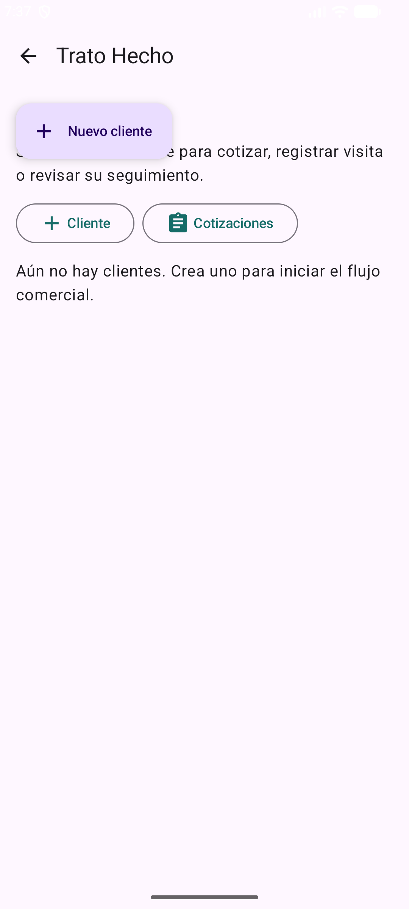

# Trato Hecho Mobile

Aplicación Android (Kotlin + Jetpack Compose) para vendedores: administra clientes y cotizaciones con varios productos o servicios, registra visitas con cámara y GPS, y guarda todo en un **microservicio propio Spring Boot + MySQL**. Consume además la API externa mindicador.cl (dólar y UF) con Retrofit.

Asignatura DSY1105 – Desarrollo de Aplicaciones Móviles (Duoc UC) · Evaluación Parcial 4 (entrega) y Parcial 5 (defensa).

## 1. Integrantes

| Integrante | Equipo |
|---|---|
| Daniel Ignacio Castro Capilla | Grupo 12 |

## 2. Funcionalidades

- Login de demostración y panel principal con contadores.
- **Clientes**: crear (formulario con validaciones en tiempo real), ver ficha, eliminar. Se guardan en el microservicio (MySQL) y se copian en Room para verlos sin conexión.
- **Cotizaciones**: varios productos/servicios por cotización, descuento, IVA, moneda, total calculado, cambio de estado (Enviada, Aceptada, Rechazada, Facturada) y eliminación.
- **Visita**: foto con la cámara y ubicación GPS, actualizados en el microservicio.
- **Indicadores económicos** (dólar y UF) desde la API externa mindicador.cl, con reintento si falla.
- **Sincronización**: al abrir la app se baja el contenido del microservicio y se refresca Room.
- Arquitectura MVVM: `ui/` (Compose) → `viewmodel/AppViewModel` → `data/TratoHechoRepository` → Retrofit (`data/remote/`) + Room (`data/`).

## 3. Endpoints

### API externa (Retrofit, `IndicadoresApi`)

| Método | URL | Uso |
|---|---|---|
| GET | `https://mindicador.cl/api` | Valor del dólar y de la UF |

### Microservicio propio (Spring Boot, `backend/tratohecho-api`, puerto 8080)

| Método | Ruta | Descripción |
|---|---|---|
| GET | `/api/clientes` | Lista clientes |
| GET | `/api/clientes/{id}` | Obtiene un cliente (404 si no existe) |
| POST | `/api/clientes` | Crea cliente (201). Valida nombre, correo, teléfono |
| PUT | `/api/clientes/{id}` | Actualiza cliente |
| DELETE | `/api/clientes/{id}` | Elimina cliente y sus cotizaciones (204) |
| GET | `/api/cotizaciones[?clienteId=]` | Lista cotizaciones (opcionalmente de un cliente) |
| GET | `/api/cotizaciones/{id}` | Obtiene una cotización con su `total` |
| POST | `/api/cotizaciones` | Crea cotización con `lineas` (201) |
| PUT | `/api/cotizaciones/{id}` | Actualiza cotización |
| PATCH | `/api/cotizaciones/{id}/estado?estado=Aceptada` | Cambia el estado |
| DELETE | `/api/cotizaciones/{id}` | Elimina cotización (204) |

Ejemplo de cuerpo para `POST /api/cotizaciones`:

```json
{ "clienteId": 1, "moneda": "CLP", "descuentoPorcentaje": 10, "impuestoPorcentaje": 19, "estado": "Borrador",
  "lineas": [ { "concepto": "Pintura", "cantidad": 2, "precioUnitario": 1000 } ] }
```

Errores de validación devuelven 400 con `{ "error": "...", "campos": { "campo": "mensaje" } }`.

## 4. Pasos para ejecutar

Requisitos: JDK 17, Android Studio, MySQL o MariaDB en `localhost:3306`.

1. **Base de datos**: crear la base y el usuario (una sola vez):
   ```sql
   CREATE DATABASE tratohecho CHARACTER SET utf8mb4;
   CREATE USER 'tratohecho'@'localhost' IDENTIFIED BY 'tratohecho123';
   GRANT ALL ON tratohecho.* TO 'tratohecho'@'localhost';
   ```
   Las tablas las crea Hibernate solas (`ddl-auto=update`). Usuario y clave se pueden cambiar con las variables `DB_URL`, `DB_USER`, `DB_PASS`.
2. **Microservicio**: `cd backend/tratohecho-api` y ejecutar `./gradlew bootRun` (Windows: `gradlew.bat bootRun`). Queda en `http://localhost:8080`.
3. **App**: abrir la raíz del proyecto en Android Studio y ejecutar en el emulador. La URL del microservicio está en `RetrofitInstance.URL_MICROSERVICIO` (`http://10.0.2.2:8080/` = el PC visto desde el emulador). En un celular real, cambiarla por `http://IP-DEL-PC:8080/` (mismo Wi‑Fi).
4. Ingresar con cualquier usuario y clave de demostración.

### Pruebas y cobertura

- App: `./gradlew :app:cobertura` → informe en `app/build/reports/jacoco/cobertura/html/index.html` (ViewModel, Repository, validadores y DTO: **86 % de líneas**). Pruebas con Kotest + MockK (repositorio y API simulados).
- Microservicio: `cd backend/tratohecho-api && ./gradlew test` → informe en `build/reports/jacoco/test/html/index.html` (**97 % de líneas**). Pruebas MockMvc con H2 en memoria.

## 5. APK firmado y .jks

- Almacén de claves: [`keystore/tratohecho.jks`](keystore/tratohecho.jks) (alias `tratohecho`, contraseña `tratohecho123`; solo para esta evaluación).
- Configuración en `app/build.gradle.kts` → `signingConfigs { release { ... } }`.
- Generar: `./gradlew :app:assembleRelease` → `app/build/outputs/apk/release/app-release.apk`.
- APK ya firmado incluido: [`release/TratoHecho-release.apk`](release/TratoHecho-release.apk).
- Evidencia de la firma (`apksigner verify` y `keytool -list`): [`docs/evidencia-apk-firmado.txt`](docs/evidencia-apk-firmado.txt). Captura de la app: 

## 6. Gestión del proyecto

- Repositorio: https://github.com/Dan1elCastroC/Trato-Hecho-Daniel-Castro
